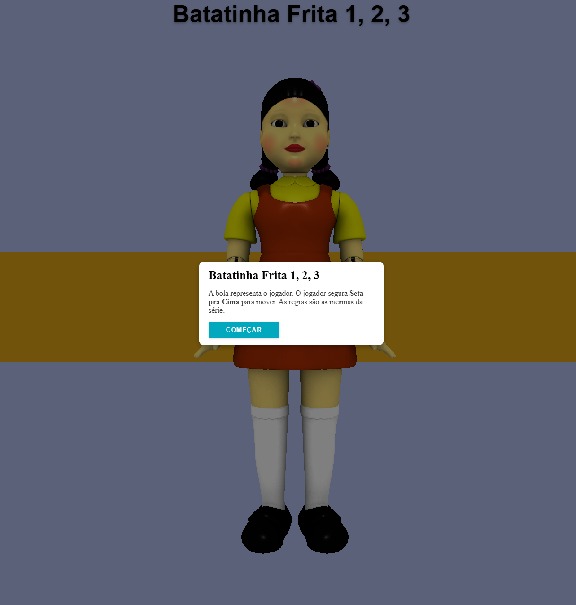
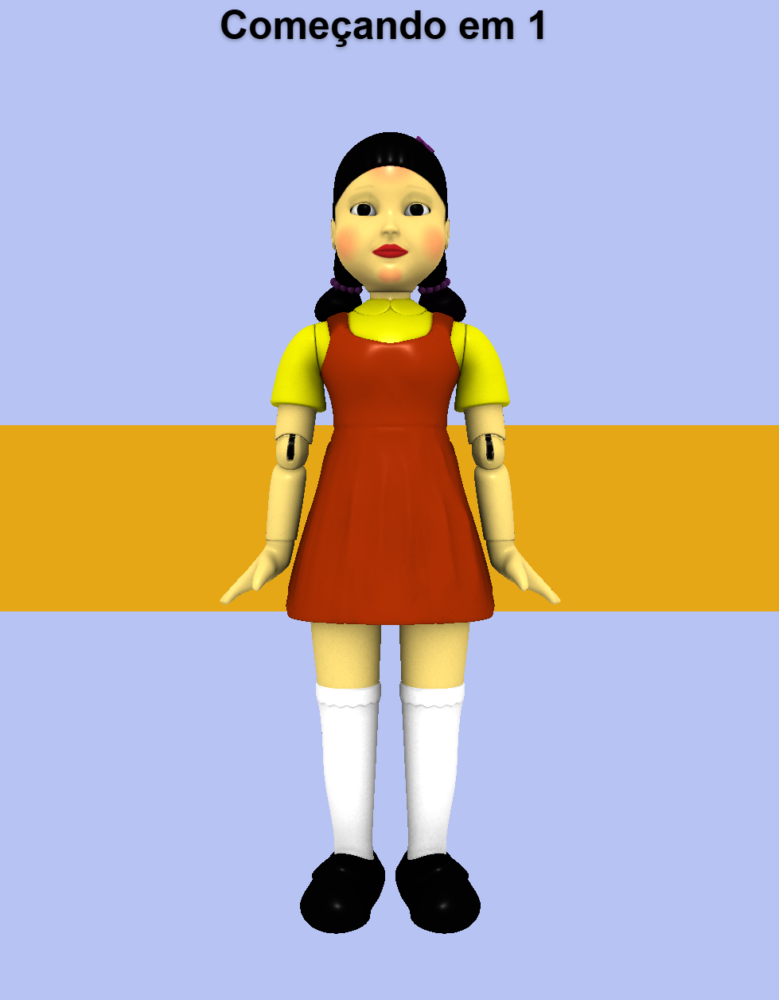
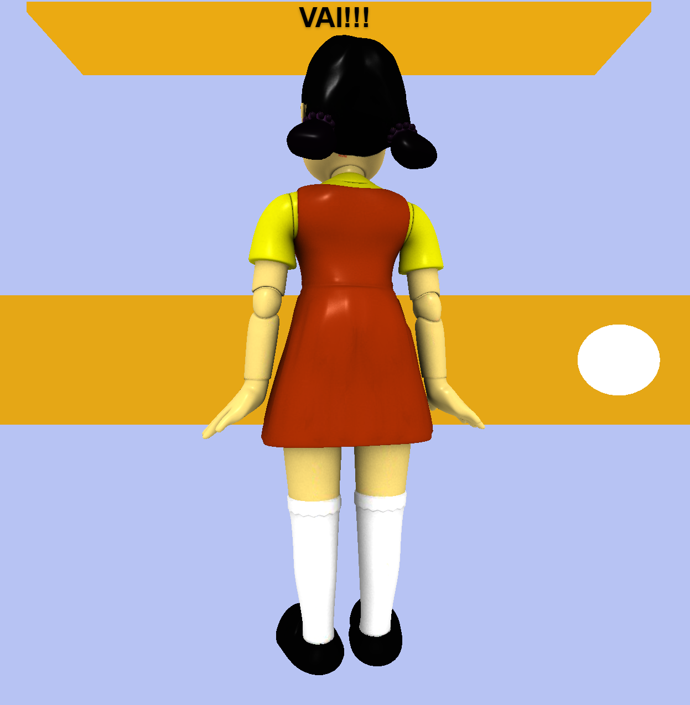
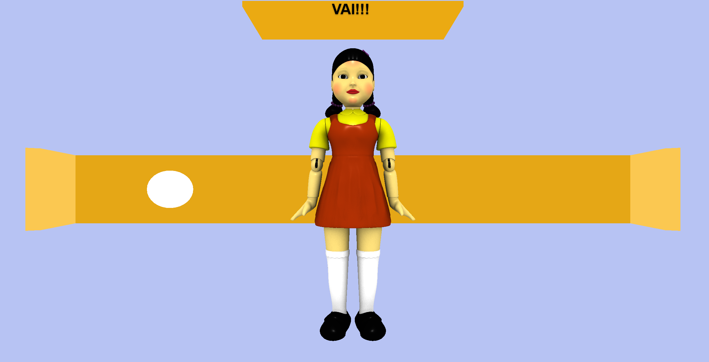
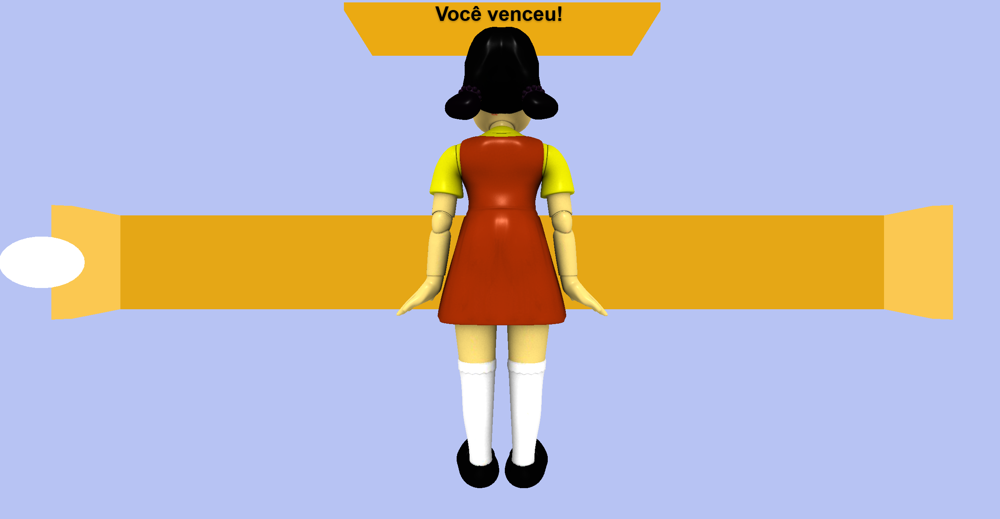
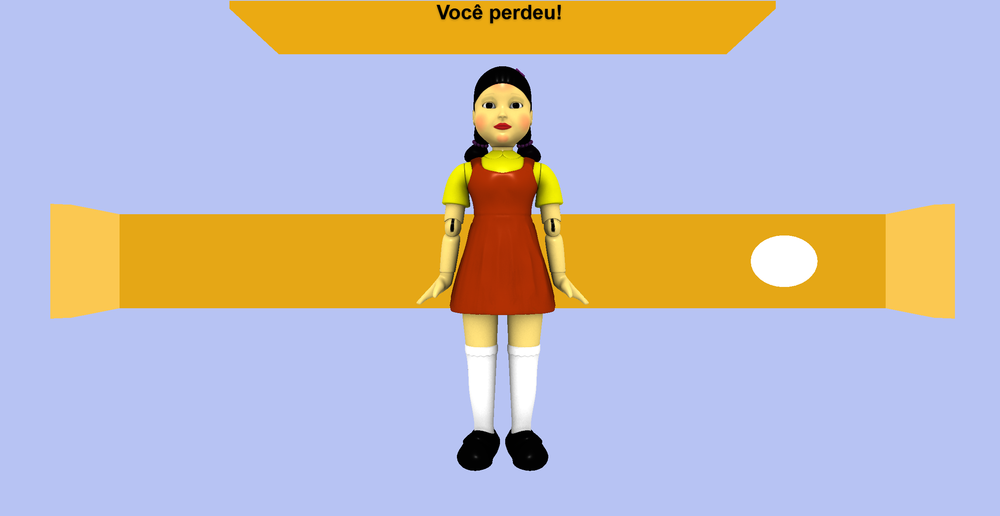
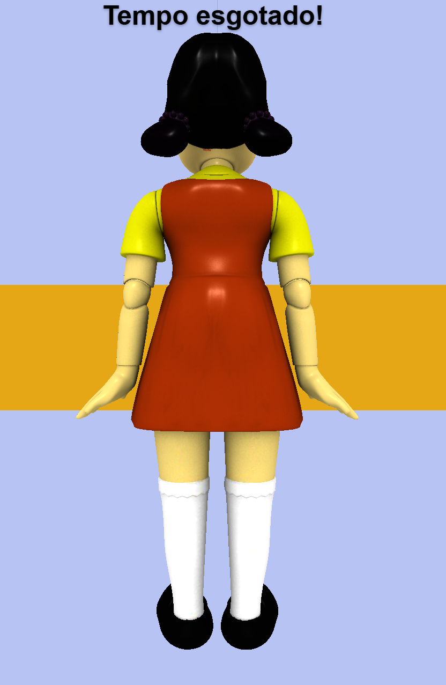

# Batatinha Frita 1, 2, 3

A small 3D browser game inspired by the *Red Light, Green Light* challenge featured in the Netflix series *Squid Game* (Round 6).

<p align="center">
  <a href="https://batatinha-frita-1-2-3.netlify.app/"><strong>Play the game</strong></a>
</p>

## Screenshots

The screenshots below walk through the main stages of the game, from the opening screen to the different possible outcomes.

### Main screen

<p align="center">
  
</p>

The opening screen welcomes the player and introduces the challenge before the game begins.

### The challenge begins

<p align="center">
  
</p>

The start of the round gives the player the chance to get ready. The goal is to move towards the finish line while paying attention to the doll.

### Gameplay

<p align="center">
  
</p>

This is the central gameplay view. The player controls the ball using the **Up Arrow** key and must move only while the doll is looking away. The player needs to stop as soon as the doll turns around.

### The doll turns around

<p align="center">
  
</p>

The doll's turn is the key moment of the challenge: the player must stop immediately. Moving while the doll is watching leads to defeat.

### Game outcomes

<p align="center">
  
  
</p>

- **Victory:** reach the finish line within the time limit to complete the challenge.
- **Defeat:** moving while the doll is looking or otherwise breaking the challenge rules ends the round.

<p align="center">
  
</p>

**Time out:** the player must also keep an eye on the countdown. If the 15-second limit expires before reaching the finish line, the round ends.

---

## How to play

- The ball represents the player.
- Hold the **Up Arrow** key to move forwards.
- Move while the doll is looking away.
- Stop when the doll turns around. Moving at the wrong time means losing the game.
- Reach the finish line before the 15-second time limit runs out.

## Built with

- HTML5
- CSS3
- JavaScript
- [Three.js](https://threejs.org/) for 3D rendering
- [GSAP](https://gsap.com/) for animations
- glTF 3D model loading

## Run locally

1. Clone the repository:
   ```bash
   git clone https://github.com/PedroHQCoelho/batatinha-frita-1-2-3.git
   ```
2. Open the project folder.
3. Start a local web server from the project directory. For example, with VS Code, use the Live Server extension.
4. Open the local address provided by the server.

A local server is recommended because the game loads its 3D model from the project files.

## Project purpose

This project was created for learning and practice, exploring browser-based 3D graphics, animation and keyboard interaction.

## Credits

The 3D doll model is **“Squid Game - Giant Doll” by Rzyas**, used under the [Creative Commons Attribution 4.0 licence (CC BY 4.0)](https://creativecommons.org/licenses/by/4.0/).

The original model is available on [Sketchfab](https://sketchfab.com/3d-models/squid-game-giant-doll-7afd49dd07714651a6afa1fc4aac8576).

## Links

- **Live game:** https://batatinha-frita-1-2-3.netlify.app/
- **Repository:** https://github.com/PedroHQCoelho/batatinha-frita-1-2-3
